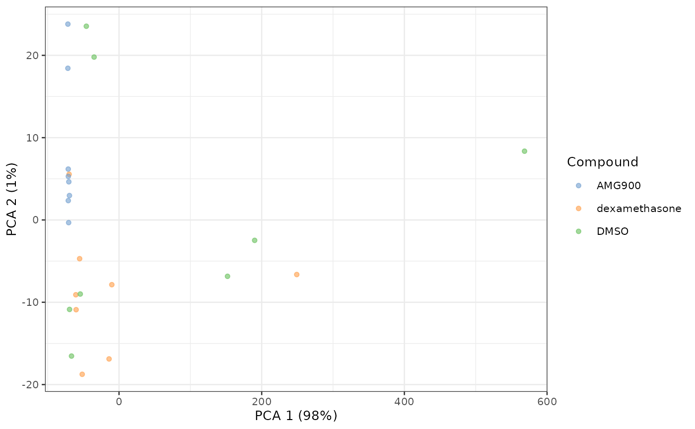
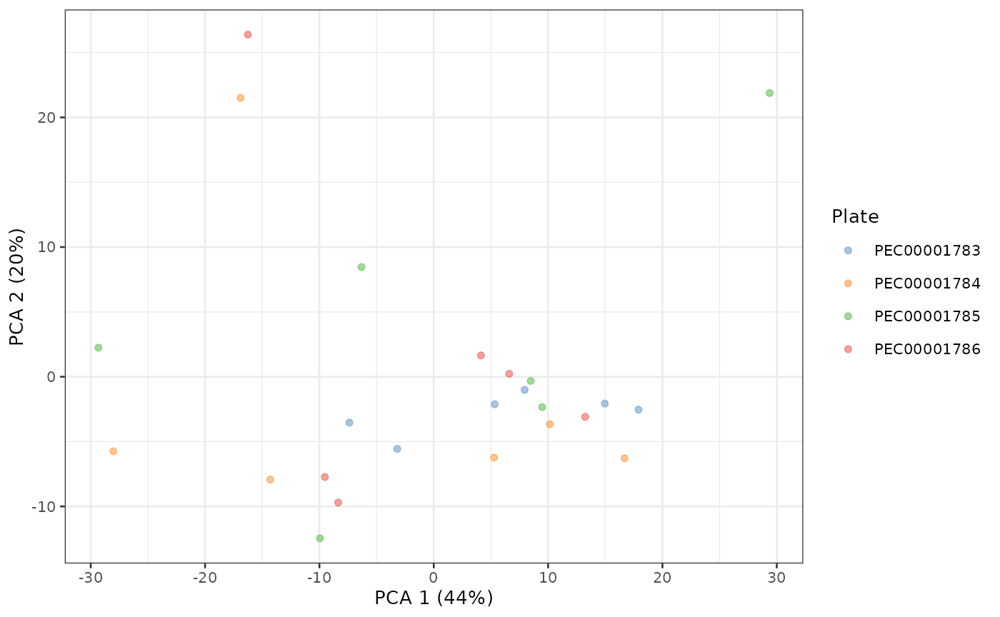
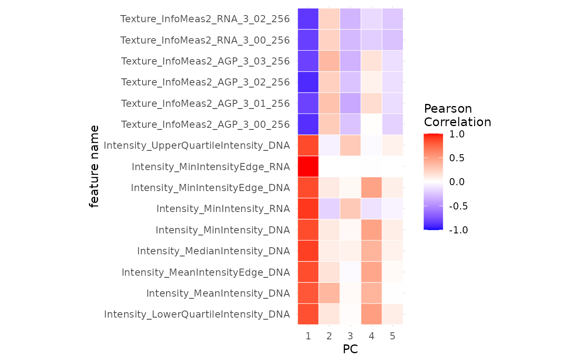
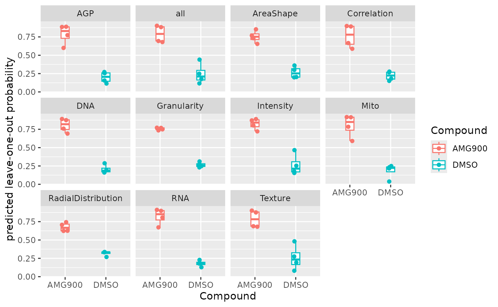
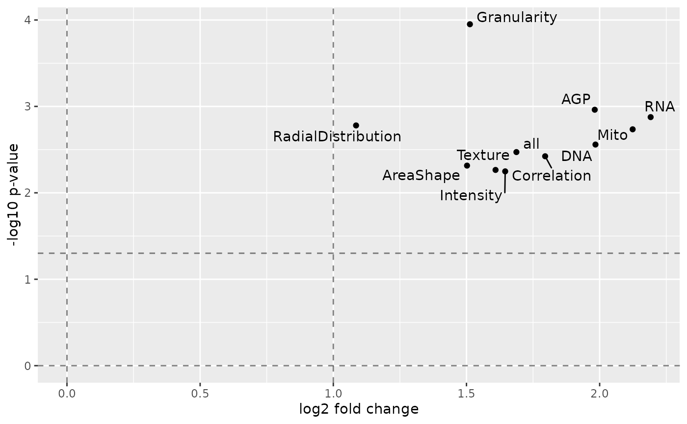
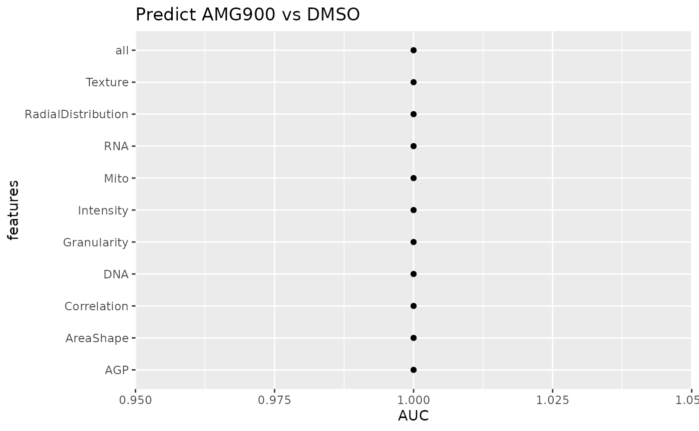
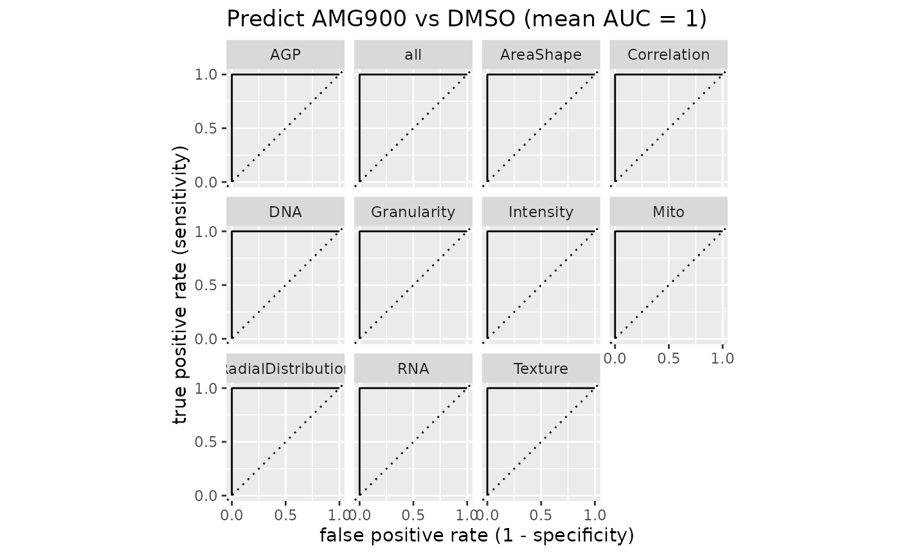
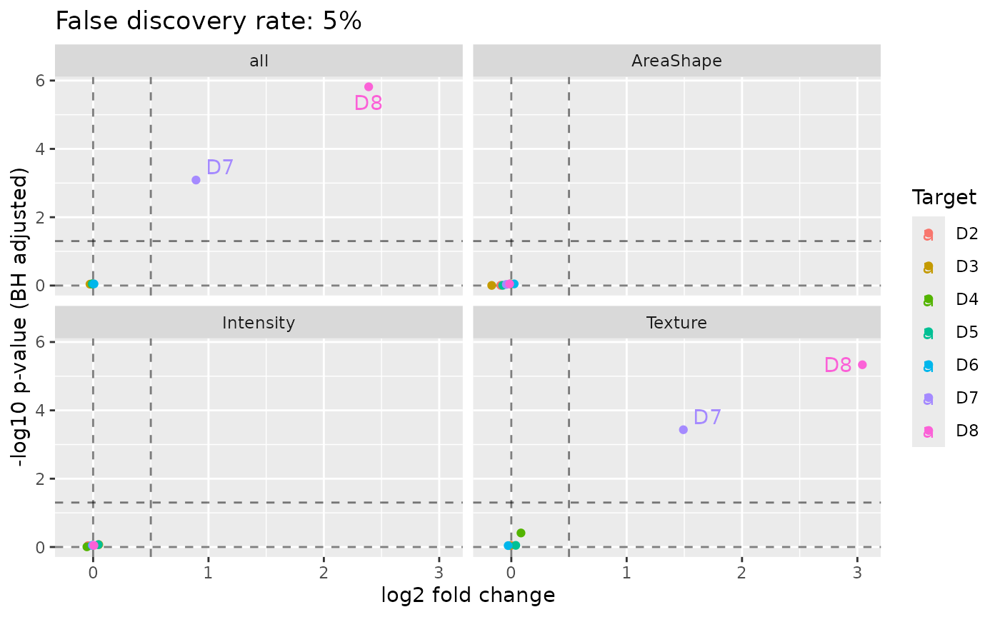

# Perturbation analysis of Cell Painting data with cellpaintr

## Introduction

High-content imaging measures the morphology of single cells in detail.
In a Cell Painting experiment, cells are stained with dyes for several
organelles, imaged, and segmented, and CellProfiler measures about 1,000
features of every cell: its size and shape, the intensity and texture of
each stain, how the stains are distributed between the nucleus and the
cell edge, and how two stains colocalize. Comparing these features
between a perturbation, such as a drug, and a control shows whether and
how the perturbation changes the cells.

cellpaintr is built for experiments with few biological replicates, such
as patient-derived cells from a handful of donors. The cells are
abundant, but the replicates are not, and the replicates, not the cells,
are the independent units. cellpaintr therefore learns on cells and
tests on replicates:

1.  For each replicate, a random forest trained on the cells of all
    other replicates scores the cells of the held-out replicate with the
    probability of the perturbed condition (pre-validation with
    replicates as folds). Every score comes from a model that never saw
    that replicate.
2.  A patient-level test compares the scores of the perturbed and the
    control cells of each replicate. Because the models of different
    held-out replicates are trained on each other’s cells, their scores
    are correlated, and an ordinary paired t-test is too liberal.
    cellpaintr offers an exact permutation test and two corrected
    t-tests.
3.  The test is repeated for interpretable feature groups, such as
    CellProfiler measurement types (intensity, texture, …) or imaging
    channels, and summarized in a volcano plot.

Profiling pipelines such as pycytominer aggregate single cells into
well-level profiles and compare profiles by their similarity. cellpaintr
instead trains on single cells, so it learns the direction of an effect
from the data, which makes it powerful when most cells shift, even
slightly, in many features, and it detects changes in the spread or
shape of a feature distribution that leave the means unchanged. A strong
response of a small subpopulation of cells, on the other hand, is
diluted in the mean score of a replicate; a location test on replicate
means, the standard patient-level analysis, detects such responses more
readily. It keeps the data in a `SingleCellExperiment`, so that tools
from Bioconductor single-cell workflows, such as `scater` and
`scrapper`, apply without conversion.

## Installation

``` r

if (!require("BiocManager", quietly = TRUE)) {
    install.packages("BiocManager")
}
BiocManager::install("cellpaintr")
```

``` r

library(cellpaintr)
library(scater)
library(scrapper)
library(purrr)
library(dplyr)
library(ggrepel)
```

## Input data

### What cellpaintr reads

cellpaintr reads the per-object table that CellProfiler’s
ExportToSpreadsheet module writes for the cells, usually called
`MyExpt_Cells.csv`, with one row per cell.
[`loadData()`](https://christofseiler.github.io/cellpaintr/reference/loadData.md)
expects

- the column `ImageNumber`, which identifies the image (site) of each
  cell, and usually `ObjectNumber`;
- image metadata columns whose names start with `Metadata_`, such as
  `Metadata_Plate`, `Metadata_Well`, `Metadata_Patient`, and
  `Metadata_Drug`. CellProfiler adds them to the cell table with the
  option “Add image metadata columns to your object data file” of
  ExportToSpreadsheet; the plate layout (which drug and which patient
  are in which well) usually comes from a metadata file loaded with the
  Metadata module;
- numeric measurement columns, such as `AreaShape_Area`,
  `Intensity_MeanIntensity_DNA`, or `Texture_Contrast_Mito_3_00_256`.
  Their names follow CellProfiler’s convention
  `<MeasurementType>_<Feature>_<Channel>_<Parameters>`, which cellpaintr
  uses to form feature groups.

[`loadData()`](https://christofseiler.github.io/cellpaintr/reference/loadData.md)
turns the `Metadata_` columns, without the prefix, together with
`ImageNumber`, `ObjectNumber`, and the cell centre coordinates
`Location_Center_X`, `_Y`, and `_Z`, into the column data of the cells,
and all other columns into the assay `features`. If the metadata were
exported only to the image table (`MyExpt_Image.csv`), join them to the
cells by `ImageNumber` first:

``` r

cells <- readr::read_csv("MyExpt_Cells.csv")
images <- readr::read_csv("MyExpt_Image.csv") |>
    select(ImageNumber, starts_with("Metadata_"))
readr::write_csv(left_join(cells, images, by = "ImageNumber"), "cells.csv")
sce <- loadData("cells.csv")
```

### Example data from the JUMP Cell Painting Consortium

The package ships a small subset of the JUMP Cell Painting dataset
(cpg0016), released under CC0 by the JUMP Cell Painting Consortium
through the Cell Painting Gallery. U2OS cells were stained for DNA
(Hoechst), RNA (SYTO 14), actin, Golgi, and plasma membrane (AGP), and
mitochondria (Mito), and imaged with brightfield as well. The subset
holds 240 cells from four compound plates of one batch: the negative
control DMSO and two of the eight JUMP positive controls, AMG900, an
Aurora kinase inhibitor with a strong effect on morphology, and
dexamethasone, a glucocorticoid with a weak one. For each plate and
compound, two random wells and, from each well, 10 random cells of one
random site were kept, with all CellProfiler measurements of the cell
compartment. The script
`system.file("scripts", "make-jump-subset.R", package = "cellpaintr")`
documents how the subset was made.

These data have no patients. Plates take their place as the replicates:
every plate carries all three compounds, so the design is paired, as in
a drug screen on patient-derived cells where every patient’s cells are
imaged with and without each drug.

``` r

cell_file <- system.file("extdata", "jump_subset.csv.gz",
    package = "cellpaintr"
)
sce <- loadData(cell_file)
sce
```

    ## class: SingleCellExperiment 
    ## dim: 1742 240 
    ## metadata(0):
    ## assays(1): features
    ## rownames(1742): AreaShape_Area AreaShape_BoundingBoxArea ...
    ##   Texture_Variance_RNA_5_02_256 Texture_Variance_RNA_5_03_256
    ## rowData names(0):
    ## colnames: NULL
    ## colData names(9): ImageNumber ObjectNumber ... Location_Center_Y
    ##   Location_Center_Z
    ## reducedDimNames(0):
    ## mainExpName: NULL
    ## altExpNames(0):

``` r

table(sce$Compound, sce$Plate)
```

    ##                
    ##                 PEC00001783 PEC00001784 PEC00001785 PEC00001786
    ##   AMG900                 20          20          20          20
    ##   dexamethasone          20          20          20          20
    ##   DMSO                   20          20          20          20

## Preprocessing

### Cells and features

CellProfiler also exports columns that describe the segmentation rather
than the cells, such as the number of child objects or the object
numbers of the nearest neighbours. Remove them before modeling.

``` r

bookkeeping <- grepl(
    "^(Parent|Children)_|ObjectNumber",
    rownames(sce)
)
sce <- sce[!bookkeeping, ]
```

Remove cells with missing measurements, features without spread, and
features that are mostly zero, which often come from empty stains or
failed measurements.

``` r

sce <- removeNAs(sce)
sce <- removeLowVariance(sce, robust = TRUE)
sce <- removeZeroInflation(sce, proportion = 0.2)
dim(sce)
```

    ## [1] 1636  240

In a full experiment, images with very few cells (out of focus, empty
wells) or very many cells (debris, clumps) are often of poor quality.
[`plotCellsPerImage()`](https://christofseiler.github.io/cellpaintr/reference/plotCellsPerImage.md)
shows the number of cells per image, and
[`removeOutliers()`](https://christofseiler.github.io/cellpaintr/reference/removeOutliers.md)
removes the cells of images outside a range. The example data keep only
10 cells of one site per well, so this step does not apply here.
Cell-level outliers can be removed with `scater`, for example cells
whose summed features lie more than three median absolute deviations
from the median.

``` r

plotCellsPerImage(sce)
sce <- removeOutliers(sce, min = 20, max = 300)
qc <- perCellQCMetrics(sce, assay.type = "features")
sce <- sce[, !isOutlier(qc$sum)]
```

### Transformation and scaling

CellProfiler features live on different scales: intensities are positive
and skewed, correlations are bounded by -1 and 1, and some texture
measures are proportions.
[`transformScale()`](https://christofseiler.github.io/cellpaintr/reference/transformScale.md)
transforms each family to an approximately unbounded, symmetric scale
(logarithm, Fisher’s z, logit, or a rank-based inverse normal
transformation), caps infinite values at the finite extremes of each
feature, and standardizes every feature, here with robust z-scores based
on the median and the median absolute deviation. The result is stored in
the new assay `tfmfeatures`.

``` r

sce <- transformScale(sce, robust = TRUE)
assayNames(sce)
```

    ## [1] "features"    "tfmfeatures"

### Plate effects

Plates often show gradients across rows and columns, for example from
evaporation at the edges.
[`removeRowColEffect()`](https://christofseiler.github.io/cellpaintr/reference/removeRowColEffect.md)
fits Tukey’s median polish to the median of each feature in each well
and subtracts the row and column effects from every cell. It needs the
factors `Row` and `Col` in the column data and many wells per plate, so
that row and column effects can be told apart from compound effects. Row
and column effects differ between plates, so with several plates, pass
the column with the plate (or batch) of each cell as `plate`, and the
median polish is fitted to each plate separately. The example data have
six wells per plate, so we skip this step:

``` r

sce$Row <- factor(substr(sce$Well, 1, 1))
sce$Col <- factor(as.integer(substr(sce$Well, 2, 3)))
sce <- removeRowColEffect(sce, plate = "Plate")
```

Note that in the JUMP layout the positive controls sit in the outer
columns of every plate and DMSO in the next columns, so compound and
plate position are confounded, and the same positional effect repeats on
every plate. A comparison between them measures compound and position
together. In your own experiments, randomize the positions of the
conditions within each replicate.

## Exploratory analysis

Single cells are noisy, so average the transformed features per well
(pseudo-bulk) with `scrapper` and look at the wells with a principal
component analysis from `scater`.

``` r

aggr <- scrapper::aggregateAcrossCells(
    assay(sce, "tfmfeatures"),
    factors = colData(sce)[, c("Plate", "Well", "Compound")]
)
sce_wells <- SingleCellExperiment(
    assays = list(means = t(t(aggr$sums) / aggr$counts)),
    colData = DataFrame(aggr$combinations, ncells = aggr$counts)
)
sce_wells <- runPCA(sce_wells,
    exprs_values = "means", ncomponents = 10, scale = TRUE
)
plotReducedDim(sce_wells, dimred = "PCA", colour_by = "Compound")
```



``` r

plotReducedDim(sce_wells, dimred = "PCA", colour_by = "Plate")
```



We scale the well means before the PCA (`scale = TRUE`). Robust z-scores
divide by the median absolute deviation, which is close to zero for some
features, such as the minimum intensity at the cell edge, so a few cells
get extreme values that would otherwise dominate the first principal
component. The random forests below are not affected, because trees do
not depend on the scale of a feature.

If the wells separate by compound, the compounds change the cells; if
they separate by plate, there are batch effects between plates.
[`plotPCACor()`](https://christofseiler.github.io/cellpaintr/reference/plotPCACor.md)
shows the features most correlated with a principal component, here the
first one.

``` r

plotPCACor(sce_wells, filter_by = 1, top = 15, assay_type = "means")
```



For larger experiments, a nonlinear embedding such as UMAP can show
groups of wells or cells that the first principal components miss, for
example with `scater::runUMAP(sce_wells, exprs_values = "means")`
followed by `scater::plotUMAP(sce_wells, colour_by = "Compound")`.

## Testing a perturbation

### Pre-validated scores

[`predictLOO()`](https://christofseiler.github.io/cellpaintr/reference/predictLOO.md)
compares two levels of a condition (`target`) with the replicates
(`group`) as the folds of the leave-one-out cross-validation. For each
plate, it trains a random forest on the cells of the other plates to
tell AMG900 from DMSO, and scores the cells of the held-out plate with
the probability of AMG900. It does this for all features together and
for each feature group: measurement types, given by the prefix of the
feature names, and channels, given by any part of them.

``` r

types <- c(
    "AreaShape", "Intensity", "Texture", "RadialDistribution",
    "Granularity", "Correlation"
)
channels <- c("DNA", "RNA", "AGP", "Mito")
set.seed(23)
sce_amg900 <- predictLOO(
    sce,
    target = "Compound", group = "Plate",
    interest_level = "AMG900", reference_level = "DMSO",
    types = types, channels = channels,
    n_threads = 1, progress = FALSE
)
reducedDim(sce_amg900, "prevalidated")[1:3, 1:4]
```

    ##             all  AreaShape  Intensity    Texture
    ## [1,] 0.53989921 0.95217937 0.76144841 0.39464127
    ## [2,] 0.03507063 0.31321508 0.04872857 0.01743730
    ## [3,] 0.01468730 0.07980873 0.04454127 0.02336667

[`plotLOO()`](https://christofseiler.github.io/cellpaintr/reference/plotLOO.md)
shows the scores averaged per plate and compound, one panel per feature
group. If the compound changes the cells, the AMG900 cells of every
plate score higher than the DMSO cells of the same plate.

``` r

plotLOO(sce_amg900, target = "Compound", group = "Plate")
```



### Patient-level tests

[`calculateStats()`](https://christofseiler.github.io/cellpaintr/reference/calculateStats.md)
averages the scores per replicate and condition, takes the difference
$`d_p`$ for each replicate $`p`$, and computes the one-sided paired
t-statistic for higher scores in the perturbed condition. It reports,
for each feature group, the $`\log_2`$ fold change of the mean scores
and a p-value from one of three calibrations.

The **permutation test** (the default) swaps the conditions of whole
replicates, refits all models for every relabeling, and compares the
observed statistic with those of the relabelings. It is exact. Swapping
the conditions of all replicates at once gives the same statistic, so
one replicate keeps its labels: with $`n`$ replicates there are
$`2^{n-1}`$ relabelings, and the smallest attainable p-value is
$`2^{1-n}`$, here $`1/8`$ with four plates. The test refits all models
for every relabeling, so it takes $`2^{n-1}`$ times as long as
[`predictLOO()`](https://christofseiler.github.io/cellpaintr/reference/predictLOO.md).

``` r

set.seed(23)
stats_permutation <- calculateStats(sce_amg900,
    target = "Compound", group = "Plate"
)
```

    ## Permutation test with all 8 relabelings of 4 levels of 'Plate' (paired design); smallest attainable p-value 1/8.

    ## 'PEC00001783' keeps its labels, because exchanging the two levels of 'Compound' in all levels of 'Plate' at once gives the same statistic.

``` r

stats_permutation
```

    ##    Target            Feature pvalue log2FoldChange
    ## 1  AMG900                all  0.125       1.687456
    ## 2  AMG900          AreaShape  0.125       1.502036
    ## 3  AMG900          Intensity  0.125       1.645348
    ## 4  AMG900            Texture  0.125       1.609109
    ## 5  AMG900 RadialDistribution  0.125       1.085425
    ## 6  AMG900        Granularity  0.125       1.512864
    ## 7  AMG900        Correlation  0.125       1.795352
    ## 8  AMG900                DNA  0.125       1.984275
    ## 9  AMG900                RNA  0.125       2.191455
    ## 10 AMG900                AGP  0.125       1.981563
    ## 11 AMG900               Mito  0.125       2.123907

11 of the 11 feature groups reach the smallest attainable p-value, 1/8:
the observed labels give the largest statistic of all relabelings. With
four replicates, no permutation p-value can be smaller, however strong
the effect, and none can pass a Bonferroni threshold over several
feature groups.

The **corrected t-test** needs no refits. Every replicate is in the
training set of every other replicate’s model, so the score differences
of different replicates are positively correlated, and the ordinary
t-statistic is too large. If each score difference is a sum of pairwise
interactions with the other replicates, it is too large by the factor
$`\sqrt{2(n-1)/(n-2)}`$, about 1.73 with four replicates; the corrected
t-test divides by it. Its p-values are not limited to multiples of
$`2^{1-n}`$, but it is approximate. Laphanuwat, Ospelt, and Seiler (in
preparation) derive this factor and compare the type I error and power
of all tests with 4 to 12 replicates, in simulations and with effects
spiked into real control wells; we plan to make the preprint available
soon.

``` r

stats_corrected <- calculateStats(sce_amg900,
    target = "Compound", group = "Plate", method = "corrected"
)
stats_corrected
```

    ##    Target            Feature       pvalue log2FoldChange
    ## 1  AMG900                all 0.0033757533       1.687456
    ## 2  AMG900          AreaShape 0.0048405582       1.502036
    ## 3  AMG900          Intensity 0.0056425419       1.645348
    ## 4  AMG900            Texture 0.0054327342       1.609109
    ## 5  AMG900 RadialDistribution 0.0016595829       1.085425
    ## 6  AMG900        Granularity 0.0001119539       1.512864
    ## 7  AMG900        Correlation 0.0037737065       1.795352
    ## 8  AMG900                DNA 0.0027620416       1.984275
    ## 9  AMG900                RNA 0.0013298322       2.191455
    ## 10 AMG900                AGP 0.0010922414       1.981563
    ## 11 AMG900               Mito 0.0018398816       2.123907

The corrected p-values range from 0.00011 to 0.00560, below the floor of
the permutation test.

The **Nadeau-Bengio correction** divides by the smaller factor
$`\sqrt{(2n-1)/(n-1)}`$ of the corrected resampled t-test of Nadeau and
Bengio (2003). It has more power when part of each score difference is
independent of the other replicates, for example noise from the random
seeds of the forests, but with four to six replicates it can exceed the
nominal level when the score differences consist mostly of interactions.

``` r

stats_nadeau_bengio <- calculateStats(sce_amg900,
    target = "Compound", group = "Plate", method = "nadeau_bengio"
)
stats_nadeau_bengio
```

    ##    Target            Feature       pvalue log2FoldChange
    ## 1  AMG900                all 2.354837e-03       1.687456
    ## 2  AMG900          AreaShape 3.392058e-03       1.502036
    ## 3  AMG900          Intensity 3.963125e-03       1.645348
    ## 4  AMG900            Texture 3.813520e-03       1.609109
    ## 5  AMG900 RadialDistribution 1.150372e-03       1.085425
    ## 6  AMG900        Granularity 7.692692e-05       1.512864
    ## 7  AMG900        Correlation 2.635846e-03       1.795352
    ## 8  AMG900                DNA 1.922682e-03       1.984275
    ## 9  AMG900                RNA 9.204738e-04       2.191455
    ## 10 AMG900                AGP 7.551798e-04       1.981563
    ## 11 AMG900               Mito 1.276300e-03       2.123907

`method = "t"` takes p-values from the t-distribution without
correction. It is fast but too liberal, and is meant for ranking many
comparisons, not for inference.

### Summaries

The volcano plot shows one point per feature group, with the $`\log_2`$
fold change against the p-value. By default, groups beyond a Bonferroni
threshold of $`0.01/G`$ for $`G`$ feature groups and a $`\log_2`$ fold
change of 1 are labeled. With four replicates, the permutation test
cannot reach this threshold, so we use the corrected t-test and a
threshold of 0.05.

``` r

volcanoPlot(sce_amg900,
    target = "Compound", group = "Plate",
    stats = stats_corrected, p_cutoff = 0.05
)
```



ROC curves and areas under the curve (AUC) describe how well the scores
of each feature group separate the two conditions. Both use the mean
score of each replicate and condition, here eight points per feature
group (four plates times two compounds), so an AUC of 1 means that every
AMG900 mean score lies above every DMSO mean score, whichever plate they
come from. The AUC is a descriptive summary; the tests of
[`calculateStats()`](https://christofseiler.github.io/cellpaintr/reference/calculateStats.md)
instead compare the conditions within each replicate.

``` r

plotAUC(sce_amg900, target = "Compound", group = "Plate")
```



``` r

plotROC(sce_amg900, target = "Compound", group = "Plate")
```



### A weak effect

Dexamethasone changes U2OS cells much less than AMG900. With few
replicates and cells, its scores barely separate from DMSO.

``` r

set.seed(23)
sce_dex <- predictLOO(
    sce,
    target = "Compound", group = "Plate",
    interest_level = "dexamethasone", reference_level = "DMSO",
    types = types, channels = channels,
    n_threads = 1, progress = FALSE
)
stats_dex <- calculateStats(sce_dex,
    target = "Compound", group = "Plate", method = "corrected"
)
stats_dex
```

    ##           Target            Feature     pvalue log2FoldChange
    ## 1  dexamethasone                all 0.90168452   -0.197356390
    ## 2  dexamethasone          AreaShape 0.02276238    0.144405946
    ## 3  dexamethasone          Intensity 0.97472932   -0.361695191
    ## 4  dexamethasone            Texture 0.91446561   -0.259349373
    ## 5  dexamethasone RadialDistribution 0.27339502    0.069529211
    ## 6  dexamethasone        Granularity 0.77807214   -0.058687876
    ## 7  dexamethasone        Correlation 0.44216536    0.009603795
    ## 8  dexamethasone                DNA 0.67034298   -0.033325508
    ## 9  dexamethasone                RNA 0.45885386    0.021194480
    ## 10 dexamethasone                AGP 0.71175296   -0.060432863
    ## 11 dexamethasone               Mito 0.53803102   -0.011598197

The smallest p-value, 0.023, does not pass a Bonferroni threshold of
$`0.05/11`$ over the feature groups. Detecting weak effects needs more
replicates; the cells per replicate help only as far as they sharpen
each replicate’s score difference.

### Run time and parallel computing

[`predictLOO()`](https://christofseiler.github.io/cellpaintr/reference/predictLOO.md)
fits one forest per replicate and feature group, and `n_threads` sets
the number of threads of each fit. The permutation test refits these
forests for every relabeling. The relabelings can run in parallel with
the future framework: set a plan before calling
[`calculateStats()`](https://christofseiler.github.io/cellpaintr/reference/calculateStats.md).
Keep the product of the number of workers and `n_threads` at or below
the number of cores.

``` r

future::plan(future::multisession, workers = 2)
stats <- calculateStats(sce_amg900, target = "Compound", group = "Plate")
future::plan(future::sequential)
```

## A drug screen with simulated data

[`generateData()`](https://christofseiler.github.io/cellpaintr/reference/generateData.md)
simulates a small CellProfiler table with 1,000 cells from six patients
and eight drugs, with 10 shape, 10 intensity, and 10 texture features
named as in real CellProfiler output. Drugs D7 and D8 shift the texture
features; D1 is the control. Every drug is compared with the control,
and the p-values of all comparisons and feature groups are adjusted
together.

``` r

set.seed(23)
sce_sim <- loadData(generateData())
sce_sim <- transformScale(sce_sim, robust = TRUE)
sce_sim$Drug <- relevel(as.factor(sce_sim$Drug), ref = "D1")
types_sim <- c("AreaShape", "Intensity", "Texture")

sce_list <- map(setdiff(levels(sce_sim$Drug), "D1"), function(drug) {
    predictLOO(
        sce_sim,
        target = "Drug", group = "Patient",
        interest_level = drug, reference_level = "D1",
        types = types_sim, n_threads = 1, progress = FALSE
    )
})
```

For a quick screen of many drugs, the corrected t-test needs no refits.
Its p-values are adjusted with the Benjamini-Hochberg procedure over all
drugs and feature groups.

``` r

p_adj_cutoff <- 0.05
fc_cutoff <- 0.5
tb_stats <- lapply(sce_list, calculateStats,
    target = "Drug", group = "Patient", method = "corrected"
) |>
    bind_rows() |>
    mutate(pvalue_adj = p.adjust(pvalue, method = "BH")) |>
    mutate(Selection = ifelse(
        pvalue_adj < p_adj_cutoff & log2FoldChange > fc_cutoff,
        Target, ""
    ))

tb_stats |>
    ggplot(aes(log2FoldChange, -log10(pvalue_adj), label = Selection)) +
    geom_vline(
        xintercept = c(0, fc_cutoff), alpha = 0.5, linetype = "dashed"
    ) +
    geom_hline(
        yintercept = c(0, -log10(p_adj_cutoff)), alpha = 0.5,
        linetype = "dashed"
    ) +
    geom_point(aes(color = Target)) +
    geom_text_repel(aes(color = Target), max.overlaps = Inf) +
    xlab("log2 fold change") +
    ylab("-log10 p-value (BH adjusted)") +
    facet_wrap(~Feature) +
    ggtitle(paste0("False discovery rate: ", 100 * p_adj_cutoff, "%"))
```



## References

Laphanuwat P, Ospelt C, Seiler C. cellpaintr: pre-validation with small
sample sizes. In preparation; we plan to make the preprint available
soon.

Nadeau C, Bengio Y (2003). Inference for the generalization error.
*Machine Learning*, 52(3), 239–281.

## Session information

``` r

sessionInfo()
```

    ## R version 4.5.3 (2026-03-11)
    ## Platform: x86_64-pc-linux-gnu
    ## Running under: Ubuntu 26.04.1 LTS
    ## 
    ## Matrix products: default
    ## BLAS:   /usr/lib/x86_64-linux-gnu/openblas-pthread/libblas.so.3 
    ## LAPACK: /usr/lib/x86_64-linux-gnu/openblas-pthread/libopenblasp-r0.3.32.so;  LAPACK version 3.12.0
    ## 
    ## locale:
    ##  [1] LC_CTYPE=C.UTF-8       LC_NUMERIC=C           LC_TIME=C.UTF-8       
    ##  [4] LC_COLLATE=C.UTF-8     LC_MONETARY=C.UTF-8    LC_MESSAGES=C.UTF-8   
    ##  [7] LC_PAPER=C.UTF-8       LC_NAME=C              LC_ADDRESS=C          
    ## [10] LC_TELEPHONE=C         LC_MEASUREMENT=C.UTF-8 LC_IDENTIFICATION=C   
    ## 
    ## time zone: UTC
    ## tzcode source: system (glibc)
    ## 
    ## attached base packages:
    ## [1] stats4    stats     graphics  grDevices utils     datasets  methods  
    ## [8] base     
    ## 
    ## other attached packages:
    ##  [1] future_1.82.0               ggrepel_0.9.8              
    ##  [3] dplyr_1.2.1                 purrr_1.2.2                
    ##  [5] scrapper_1.4.0              scater_1.38.1              
    ##  [7] ggplot2_4.0.4               scuttle_1.20.0             
    ##  [9] cellpaintr_0.99.8           SingleCellExperiment_1.32.0
    ## [11] SummarizedExperiment_1.40.0 Biobase_2.70.0             
    ## [13] GenomicRanges_1.62.1        Seqinfo_1.0.0              
    ## [15] IRanges_2.44.0              S4Vectors_0.48.1           
    ## [17] BiocGenerics_0.56.0         generics_0.1.4             
    ## [19] MatrixGenerics_1.22.0       matrixStats_1.5.0          
    ## [21] BiocStyle_2.38.0           
    ## 
    ## loaded via a namespace (and not attached):
    ##  [1] gridExtra_2.3.1     rlang_1.3.0         magrittr_2.0.5     
    ##  [4] furrr_0.4.0         otel_0.3.0          compiler_4.5.3     
    ##  [7] systemfonts_1.3.4   vctrs_0.7.3         stringr_1.6.0      
    ## [10] crayon_1.5.3        pkgconfig_2.0.3     fastmap_1.2.0      
    ## [13] XVector_0.50.0      labeling_0.4.3      rmarkdown_2.32     
    ## [16] tzdb_0.5.0          ggbeeswarm_0.7.3    ragg_1.5.2         
    ## [19] bit_4.6.0           xfun_0.62           cachem_1.1.0       
    ## [22] beachmat_2.26.0     jsonlite_2.0.0      DelayedArray_0.36.1
    ## [25] BiocParallel_1.44.0 irlba_2.4.1         parallel_4.5.3     
    ## [28] R6_2.6.1            bslib_0.12.0        stringi_1.8.9      
    ## [31] rsample_1.3.2       RColorBrewer_1.1-3  ranger_0.18.0      
    ## [34] parallelly_1.50.0   jquerylib_0.1.4     Rcpp_1.1.2         
    ## [37] bookdown_0.48       knitr_1.52          future.apply_1.21.0
    ## [40] readr_2.2.0         Matrix_1.7-4        tidyselect_1.2.1   
    ## [43] abind_1.4-8         yaml_2.3.12         viridis_0.6.5      
    ## [46] codetools_0.2-20    listenv_1.1.0       lattice_0.22-9     
    ## [49] tibble_3.3.1        withr_3.0.3         S7_1.0.0           
    ## [52] evaluate_1.0.5      desc_1.4.3          pillar_1.11.1      
    ## [55] BiocManager_1.30.27 vroom_1.7.1         hms_1.1.4          
    ## [58] scales_1.4.0        globals_0.20.0      glue_1.8.1         
    ## [61] tools_4.5.3         BiocNeighbors_2.4.0 ScaledMatrix_1.18.0
    ## [64] fs_2.1.0            grid_4.5.3          yardstick_1.5.0    
    ## [67] tidyr_1.3.2         beeswarm_0.4.0      BiocSingular_1.26.1
    ## [70] vipor_0.4.7         cli_3.6.6           rsvd_2.0.0         
    ## [73] textshaping_1.1.0   parsnip_1.6.1       S4Arrays_1.10.1    
    ## [76] viridisLite_0.4.3   gtable_0.3.6        sass_0.5.0         
    ## [79] digest_0.6.39       SparseArray_1.10.10 farver_2.1.2       
    ## [82] htmltools_0.5.9     pkgdown_2.2.1       lifecycle_1.0.5    
    ## [85] hardhat_1.4.3       sparsevctrs_0.4.0   bit64_4.8.6
